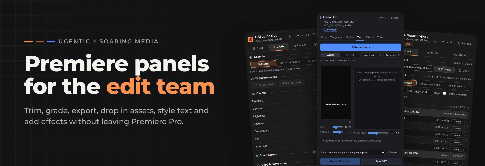
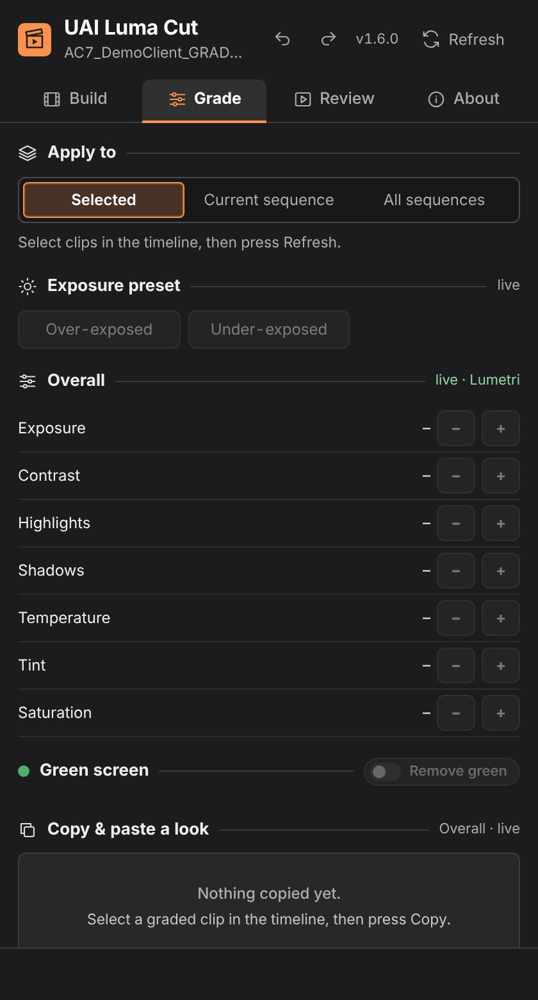
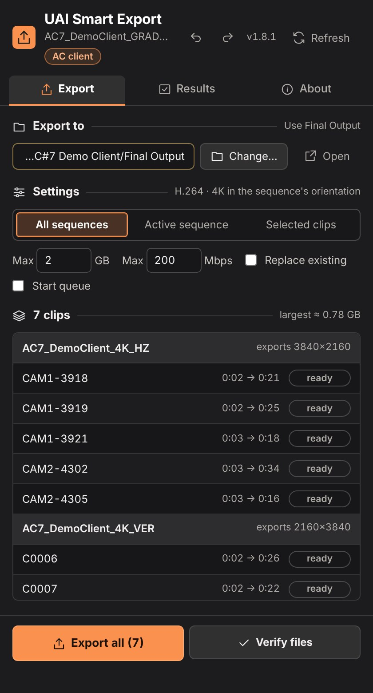
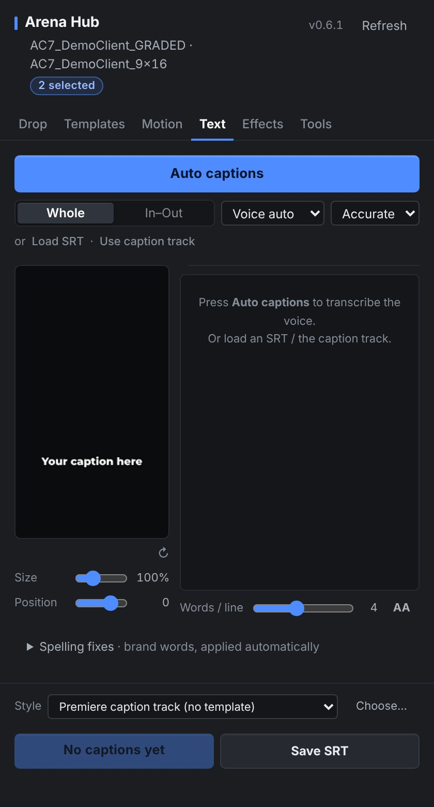

<p align="center"></p>

<p align="center">
  
  
  
  
  
  
</p>

<p align="center">
  Premiere Pro tools for the <b>UGENTIC × Soaring Media</b> edit team · macOS · Premiere Pro 2020+ (built and tested on 2027)
</p>

<p align="center">
  <a href="#install">Install</a> ·
  <a href="#whats-new">What's new</a> ·
  <a href="#uai-luma-cut">Luma Cut</a> ·
  <a href="#uai-smart-export">Smart Export</a> ·
  <a href="#agentix-arena-hub">Arena Hub</a> ·
  <a href="#mcp-for-adobe-premiere-pro">Premiere MCP</a> ·
  <a href="../../issues/new/choose">Report a problem</a>
</p>

---

## The toolkit

| Tool | What it does | Where |
|---|---|---|
| **UAI Luma Cut** | Sets up an S-Log client: trims each clip's pauses, applies the house grade, builds the 8K / 4K, horizontal / vertical timelines, live grading and review. | this repo |
| **UAI Smart Export** | Exports every clip as its own 4K H.264 file under 2 GB, named after the clip, straight into Final Output, then verifies each file. | this repo |
| **Agentix Arena Hub** | Drop any file or link, offline auto captions you can edit, CapCut-style effects, smart adjustment layers and mattes. | [agentix-arena-hub](https://github.com/agentixclaude/agentix-arena-hub) |
| **Premiere MCP** | Lets Claude read and drive Premiere (timelines, clips, effects, exports). Team-tested version, one installer. | [`mcp/`](mcp/) |

## What's new
**Luma Cut 1.9.0** · 2026-11-25 17:45
- **Proxies** — Build › Proxies: 1080p ProRes Proxy for every 4K–8K clip, attached and switched on. **Auto** (on by default) does it for every project by itself. Exports still use the originals

**Luma Cut 1.8.2** · 2026-11-25 16:20
- **How to use** — About › How to use: the 8 steps from client folder to verified export. Same steps on GitHub: [Start a client](docs/how-to-start.md)

**Luma Cut 1.8.1** · 2026-11-25 13:45 — trim engine ignores spoken count-ins · **1.8.0** — face trim in Standalone, learned grade priors · **1.7.0** — Check light & colour

**Luma Cut 1.6.0** · 2026-11-24 15:08
- **About** — New updates: every version with its date, time and what changed
- **Undo / Redo** — Undo and Redo buttons in the header; Cmd+Z / Shift+Cmd+Z work inside the panel too (Premiere's own undo)

**Smart Export 1.8.1** · 2026-11-24 15:08
- **About** — New updates: every version with its date, time and what changed
- **Undo / Redo** — Undo and Redo buttons in the header; Cmd+Z / Shift+Cmd+Z work inside the panel too

Full history: About → New updates in each panel.

Arena Hub: see its [What's new](https://github.com/agentixclaude/agentix-arena-hub#whats-new).

## Install

Quit Premiere Pro, open **Terminal**, paste a line, press Return.

**Luma Cut + Smart Export**
```bash
curl -fsSL https://raw.githubusercontent.com/agentixclaude/uai-premiere-panels/main/install.sh | bash
```
Only one of them: add `-s lumacut` or `-s export` after `bash`.

**Arena Hub**
```bash
curl -fsSL https://raw.githubusercontent.com/agentixclaude/agentix-arena-hub/main/install.sh | bash
```

**Premiere MCP (for Claude)**
```bash
curl -fsSL https://raw.githubusercontent.com/agentixclaude/uai-premiere-panels/main/mcp/install-mcp.sh | bash
```

Then open Premiere › **Window › Extensions** and pick the panel. Every panel updates itself: when a new version is out it shows **Update now**, then restart Premiere.

Needs a Mac, Premiere Pro 2020 or newer, Adobe Media Encoder (for Smart Export). ffmpeg is added automatically when Homebrew is installed.

---

## UAI Luma Cut

<table><tr>
<td width="34%" valign="top"></td>
<td valign="top">

**Client setup in one press.** Choose the client folder (the one holding *Raw Data* and *Project File*), pick **Standalone** or **Claude**, press **Analyse and build**.

- **Build**: trims from the audio, applies the S-Log grade, makes `<Client>_8K_HZ / 8K_VER / 4K_HZ / 4K_VER` with IN/OUT markers; content-based duplicate check.
- **Grade**: all live, ⌘Z undoes. Over / under-exposure presets, Overall Lumetri, one-click green-screen removal, copy & paste a look. Scope: selected, sequence or all.
- **Review**: flagged clips, re-sync markers, save grade references, final check that feeds the learning.
- **About**: what changed in each version.

**New here? [Start a client in 13 steps →](docs/how-to-start.md)** · [Full Luma Cut guide →](docs/luma-cut.md)

</td></tr></table>

## UAI Smart Export

<table><tr>
<td width="34%" valign="top"></td>
<td valign="top">

**Every clip out as its own file.** File name = clip name, folder = the client's **Final Output**.

- 4K in the sequence's orientation (3840×2160 or 2160×3840), H.264, Rec.709, AAC 320 kbps.
- Always under the size cap (2 GB by default); bitrate worked out per clip.
- Export all / active sequence / selected clips; existing files skipped unless *Replace existing*.
- **Verify files** checks codec, frame size and size of every output.

[Full Smart Export guide →](docs/smart-export.md)

</td></tr></table>

## Agentix Arena Hub

<table><tr>
<td width="34%" valign="top"></td>
<td valign="top">

**The creative panel.** Lives in its own repo with its own guide: **[agentixclaude/agentix-arena-hub](https://github.com/agentixclaude/agentix-arena-hub)**.

- **Drop**: images, video, audio, folders, Drive / Dropbox links, YouTube, Instagram, TikTok… into `Assets/Drops`, converted so Premiere always plays them.
- **Text**: **Auto captions** transcribed on your Mac, offline; unsure words flagged to check, brand-word spelling fixes, placed as editable Graphics text or a caption track.
- **Effects**: 31 CapCut-style effects on Premiere 2027's new effects, with previews.
- **Tools**: adjustment layers and mattes over a section, never overwriting.

</td></tr></table>

## MCP for Adobe Premiere Pro

Lets Claude (Desktop or Code) work inside Premiere. It is the open-source [premiere-pro-mcp](https://github.com/leancoderkavy/premiere-pro-mcp) (MIT) at the version the team has tested; the installer sets up the server, its Premiere connector and Claude Desktop in one go. First prompt after installing: **"verify my Premiere connection"**. Rules and troubleshooting: [`mcp/README.md`](mcp/README.md).

---

## Help

- Something broke or looks wrong → **[Report a problem](../../issues/new/choose)** (pick the panel, add the version from its header and a screenshot).
- Idea for a tool → same page, **Request a feature**.
- Maintainers: [how updates, versions and new panels work](docs/maintainers.md).

<sub>Internal tools for the UGENTIC × Soaring Media team. The repo is public: never commit client footage, exports, project files, keys or passwords.</sub>
