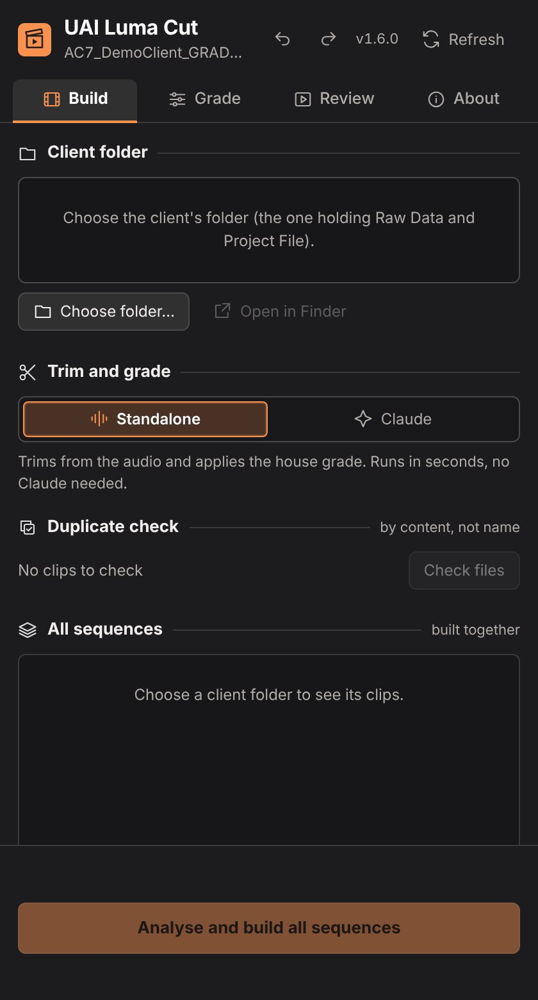
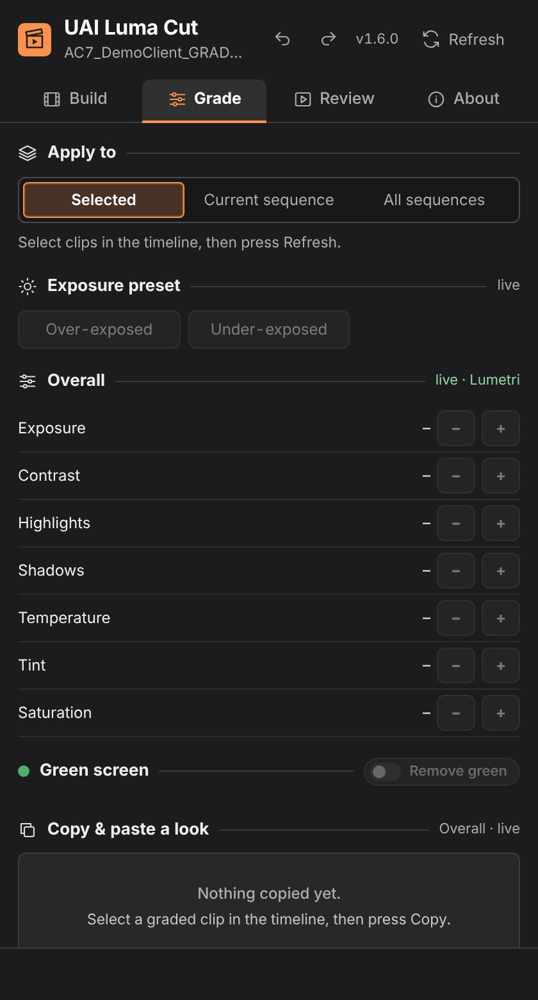
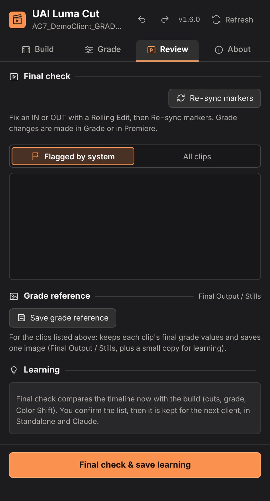

# UAI Luma Cut — guide

[← Back to the panels](../README.md)

<table><tr>
<td width="33%"> Build</td>
<td width="33%"> Grade</td>
<td width="33%"> Review</td>
</tr></table>

1. **Choose folder…** — the client folder holding `Raw Data` (any folder starting with "Raw") and `Project File`. Folders named like `AC#3 …` are marked **AC client**.
2. **New project for this client** — creates or opens `Project File/<Client>_GRADED.prproj` (e.g. `AC3_ScottFeirn_GRADED`).
3. Pick the mode, then press the big button.

**Standalone** (no Claude): trims from the audio, about 0.8 s before the first word and 0.6 s after the last word, and applies the house grade. Seconds per client.

**Claude**: press **Ask Claude**. The panel writes `luma_request.json` and copies a prompt; paste it into the Claude desktop app on the same Mac. Claude runs the engine (`~/UAI Luma Cut/engine`): IN/OUT on a frame with the mouth closed and the eyes open, and a grade matched per clip (skin brightness and colour, highlights). When `luma_plan.json` appears, the panel shows **Plan ready**; press **Build from Claude's plan**.

Every build makes:
- a `Sequences` bin with one sequence per size and orientation: `<Client>_8K_HZ`, `_8K_VER`, `_4K_HZ`, `_4K_VER`;
- each clip cut head | body | tail, with head and tail left on the timeline, disabled; IN/OUT markers on every body (flagged clips get a red OUT marker);
- one **S-Log Lumetri** per body clip (ALEXA LogC2Rec709 LUT + grade); vertical clips rotated;
- the S-log Project-panel columns, then a save.

Build always makes all sequences together; building again replaces the `Sequences` bin (press twice to confirm).

**Proxies** (Build): every 4K+ clip in the open project (long edge above 2560 px) gets a 1080p ProRes Proxy, encoded with ffmpeg on Apple's media engines (VideoToolbox decode, scale and ProRes encode; software ProRes when that fails), saved as `<client>/Proxies/<clip>_Proxy.mov` (sub-folders under Raw Data are mirrored, so cards restarting at C0001 never collide), attached to every clip that uses the file, and Premiere's proxy display is switched on (app-wide) and the project saved. A proxy file that already exists is attached, not made again. **Auto** (on by default, stored per Mac) checks the open project every 20 s, so clips dropped in by hand or imported by a build get theirs without a click; a clip that failed is skipped by Auto until you press Make proxies. Exports always use the original files.

**Duplicate check** (Build, also runs before every build): decided by content, never by file name. Same size + sampled hash + full SHA-1 = identical copy, skipped. Same shape and length + matching sound at 5 time-aligned points + matching keyframes = same recording in another file, kept and flagged. Everything else is a different take (`CAM2-4309 (1).MP4` included). Results are cached per file (path, size, modified time) in `~/UAI Luma Cut/dupe_cache.json`. The XML it imports is kept as `Project File/<Client>_GRADED.xml`.

**Skin (Custom) pass** — `engine/colormode/cm_clone.py` copies one clip's Color Mode adjustment (Color Shift on skin) to other clips in the saved project and sets each group's Hue / Lum Shift, the same as the Color tab's *Paste Grade → Paste and Replace*. Close the project in Premiere first. Example groups file: one entry per look (office/library, green screen, outdoor) with `from`, `to`, `hue`, `lum`. `cm_tool.py read` lists every clip's values.

**Grade** (all live, Cmd+Z undoes; the panel never saves, closes or reopens the project) — scope Selected / Current sequence / All sequences; Over / Under exposure presets; Overall Lumetri sliders; Remove green (Ultra Key); **Copy / Paste a look**: select a graded clip → Copy, select other clips → Paste (Overall). The default skin + green Color Shift (skin Hue +3.5 Sat +3, green Sat +5) is written once at the end of Build, in the same save and reopen as the build; per-clip skin / green changes are made and copied in Premiere's Color tab (Copy Grade / Paste Grade), because Premiere's scripting can't change Color Shift live.

**Light check** (Grade, live, Cmd+Z undoes) — **Check light & colour** exports each clip's graded mid-clip frame, reads its light graph (face/skin brightness, 99.5% highlight point) and skin colour balance, and nudges that clip's Exposure, Highlights, Temperature and Tint toward the target for its setup (office C00xx, green screen CAM, outdoor VG). It exports and measures again after each change (up to 3 rounds). Targets are the medians of your saved grade references for that setup (Review → Save grade reference); built-in defaults are used only until references exist. Outdoor VG stays within Temp −4…+8 and Tint −2…+4. Every run is logged next to the project as `luma_lightcheck.json`.

**Review** — Flagged by system / All clips; a click on a clip selects that exact timeline item. Move a cut with a Rolling Edit, then **Re-sync markers**. **Save grade reference** keeps each listed clip's grade values plus one image (`Final Output/Stills/<clip>_REF.jpg`, 1920 px) and a 320 px copy for learning. **Final check & save learning**: first press compares the timeline with the build baseline (IN/OUT, Lumetri, skin and green Color Shift) and lists the changes; second press keeps them.

**Learning** (`~/UAI Luma Cut/learning`): one batch per client project (the client of the project that is open, from 1.7.0); only the last 3 batches are kept by default (About: latest only / 3 / 5), capped at 10 MB including images; older batches are erased after a new one is saved. Rules (bounded mean corrections) only switch on after the same correction appears in 2 batches; Standalone applies the Lumetri and trim rules, Claude reads `claude_context.json`. Reset learning (About) keeps a backup file.

Limits: Premiere's scripting cannot set the Lumetri LUT directly, so the grade comes in through the imported XML. Project-panel sorting is a manual click (Video Info header, arrow down).

## Both panels
- **Undo / Redo** buttons in the header (Premiere's own history; Cmd+Z / Shift+Cmd+Z also work while the panel has focus).
- **About → New updates**: each version with its date and time and what changed (before → now), from the panel's `changelog.json`. Add an entry there with every release.
