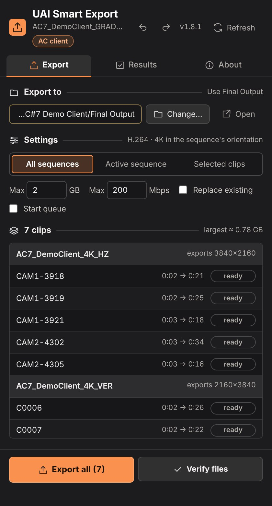

# UAI Smart Export — guide

[← Back to the panels](../README.md)

- **Export all** queues each enabled clip on V1 as its own file, cut straight from the sequence, so grade and trim changes are always what exports.
- File name = clip name (`CAM1-3918.mp4`); folder = the client's **Final Output** (or **Browse…**).
- Every file is 4K in its sequence's orientation (3840×2160 or 2160×3840), H.264, Rec.709, AAC 320 kbps, and under the size cap (2 GB default); bitrate = min(200, 15200 ÷ seconds − 0.32) Mbps.
- Source: always the original media, never proxies. Media Encoder renders the original files even while Premiere shows proxies, so 8K footage edited on proxies exports at full quality (checked 25 Nov 2026 with a proxy marked by a red box: the export contained none of it).
- **Verify files** (Results tab) reads every output: exists, H.264, the expected frame size (ffprobe) and under the cap; only files that pass every check show *verified*.

Existing files are skipped unless *Replace existing files* is ticked.

## Both panels
- **Undo / Redo** buttons in the header (Premiere's own history; Cmd+Z / Shift+Cmd+Z also work while the panel has focus).
- **About → New updates**: each version with its date and time and what changed (before → now), from the panel's `changelog.json`. Add an entry there with every release.
